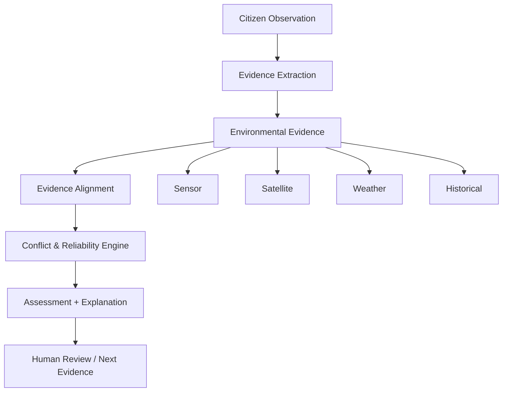

# AquaTrust — Evidence-Aware AI for Reliable Citizen Freshwater Observations

**OneAquaHealth IEEE Global Hackathon 2026 — Track 3: AI-Supported Assessment**

## Problem

Citizen scientists collect valuable freshwater observations, but these observations are often unverified. Without cross-source validation, it is difficult to distinguish genuine anomalies from misperceptions, sensor errors, or incomplete data.

## Research Question

> Can cross-source evidence verification improve the reliability of citizen-generated freshwater ecosystem observations while preserving human oversight?

## Motivation

Current citizen-science platforms typically accept observations at face value. AquaTrust introduces an **evidence-aware validation layer** that:

1. Accepts citizen freshwater observations
2. Collects and represents environmental evidence from multiple sources
3. Aligns evidence spatially and temporally
4. Detects agreement and conflict
5. Estimates evidence reliability
6. Produces assessment confidence and uncertainty
7. Explains why the assessment was produced
8. Triggers human review when evidence is insufficient or conflicting
9. Recommends what additional evidence should be collected

**AquaTrust does NOT replace human judgment. It assists it.**

## Architecture



## Core Workflow

1. **Citizen submits observation** — location, timestamp, water clarity, visible waste, algae, odor
2. **Evidence is collected** — sensor data, satellite imagery, weather context, historical baseline
3. **Evidence is aligned** — spatial, temporal, and quality alignment scores computed
4. **Conflict detection** — agreement, partial agreement, conflict, or insufficient evidence
5. **Reliability calculation** — evidence reliability score (prototype metric)
6. **Confidence calculation** — assessment confidence score (prototype metric)
7. **Assessment generated** — with full explanation
8. **Human review** — triggered when evidence is insufficient or conflicting
9. **Next evidence recommended** — deterministic rule-based suggestions

## Evidence Model

Every evidence source is represented independently:

| Source | Type | Key Fields |
|--------|------|------------|
| Citizen | `citizen` | water_clarity, visible_waste, algae, odor |
| Sensor | `sensor` | turbidity, ph, conductivity, temperature |
| Satellite | `satellite` | anomaly_score, ndvi, cloud_cover |
| Weather | `weather` | rainfall_mm, temperature, wind_speed |
| Historical | `historical` | baseline_normal, turbidity, seasonal_norm |

## Conflict Detection

The conflict engine distinguishes four statuses:

- **SUPPORTED** — Multiple independent sources support the citizen observation
- **PARTIALLY_SUPPORTED** — Some sources support, but conflicts exist
- **CONTRADICTED** — Independent sources contradict the citizen observation
- **INSUFFICIENT_EVIDENCE** — Not enough evidence available for reliable assessment

All conflict detection is **deterministic** — no LLM decides conflicts.

## Reliability vs Confidence

These are **separate concepts**:

- **Evidence Reliability** — How trustworthy are the available evidence sources? (source quality, coverage, diversity)
- **Assessment Confidence** — How strongly does the combined evidence support the final assessment? (agreement, reliability, evidence status)

Both are **prototype metrics**, not scientifically validated measurements.

## Human-in-the-Loop

When evidence conflicts, confidence is low, or evidence is missing, the system sets `requires_human_review = true`. Reviewers can:

- Approve the assessment
- Reject the assessment
- Request more evidence
- Add comments

The original AI assessment is always preserved. Human decisions are stored as separate provenance events.

## Next-Best-EVIDence

Deterministic rule-based recommendations:

| Condition | Recommendation |
|-----------|---------------|
| Sensor missing | Collect sensor/turbidity measurement |
| Citizen vs sensor conflict | Repeat turbidity measurement |
| Multiple sources conflict | Request human review |
| Insufficient evidence | Collect additional independent evidence |
| Low quality photo | Request clearer photo or description |

## Demo Scenarios

Four deterministic scenarios for hackathon demonstration:

1. **Agreement** — Citizen cloudy + sensor high turbidity + satellite anomaly → `SUPPORTED`
2. **Citizen Conflict** — Citizen opaque + sensor normal + satellite no anomaly → `CONTRADICTED`
3. **Sensor Conflict** — Citizen cloudy + sensor normal + satellite anomaly → `PARTIALLY_SUPPORTED`
4. **Missing Evidence** — Citizen cloudy + no sensor + satellite unclear → `INSUFFICIENT_EVIDENCE`

## Evaluation

Run the evaluation script:

```bash
cd backend
python ../experiments/evaluate.py
```

This produces a **controlled synthetic evaluation** of the four demo scenarios. It is NOT a scientific validation.

## Limitations

- **Prototype reliability/confidence framework** — not regulatory or scientifically validated
- **Synthetic demo data** — demo scenarios use controlled synthetic data, not real-world measurements
- **Simple geospatial** — uses basic haversine distance, not full GIS
- **No real satellite/sensor APIs** — mock providers only; real APIs can be plugged in later
- **No authentication** — not intended for production use
- **No gamification or social features** — focused on research contribution

## Setup

### Prerequisites

- Python 3.14+
- Node.js 18+ (for frontend)

### Backend

```bash
cd backend
pip install -r requirements.txt
uvicorn app.main:app --reload
```

The backend runs on `http://localhost:8000` with SQLite by default (no PostgreSQL needed).

### Frontend

```bash
cd frontend
npm install
npm run dev
```

The frontend runs on `http://localhost:3000` and proxies API calls to the backend.

### Docker (optional)

```bash
docker-compose up
```

## API Overview

| Endpoint | Method | Description |
|----------|--------|-------------|
| `/health` | GET | Health check |
| `/api/observations` | POST | Create observation |
| `/api/observations/{id}` | GET | Get observation |
| `/api/evidence` | POST | Submit evidence |
| `/api/evidence/{observation_id}` | GET | Get evidence for observation |
| `/api/assessments/{observation_id}` | POST | Run assessment |
| `/api/assessments/{observation_id}` | GET | Get latest assessment |
| `/api/assessments/{observation_id}/explanation` | GET | Get explanation |
| `/api/observations/{id}/next-evidence` | GET | Get next evidence recommendation |
| `/api/reviews` | POST | Submit human review |
| `/api/reviews/{id}` | GET | Get review |
| `/api/demo/scenarios` | GET | List demo scenarios |
| `/api/demo/scenarios/{id}` | GET | Get scenario definition |
| `/api/demo/scenarios/{id}/run` | POST | Run scenario end-to-end |

## Project Structure

```
aquatrust/
├── backend/
│   ├── app/
│   │   ├── api/           # FastAPI routers
│   │   ├── models/        # SQLAlchemy models
│   │   ├── schemas/       # Pydantic schemas
│   │   ├── services/      # Core business logic
│   │   ├── config.py
│   │   ├── database.py
│   │   └── main.py
│   └── requirements.txt
├── frontend/
│   ├── src/
│   │   ├── components/    # React components
│   │   ├── pages/         # Page components
│   │   ├── api/           # API client
│   │   ├── types/         # TypeScript types
│   │   └── App.tsx
│   └── package.json
├── tests/                 # Pytest test suite
├── experiments/           # Evaluation scripts
├── docs/                  # Documentation
├── data/                  # Data directories
└── docker-compose.yml
```

## Research Integrity

This is a **research prototype**. The reliability and confidence scores are **prototype metrics**, not regulatory measurements. The system is designed to demonstrate the research contribution of cross-source evidence verification for citizen science, not to replace certified environmental monitoring.

## License

MIT License — for hackathon and research use.
