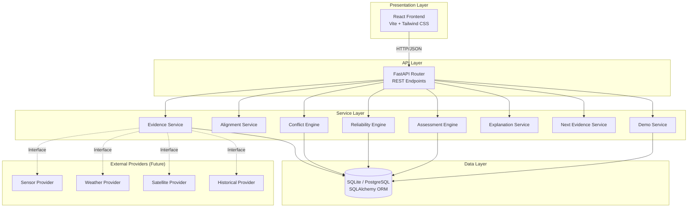
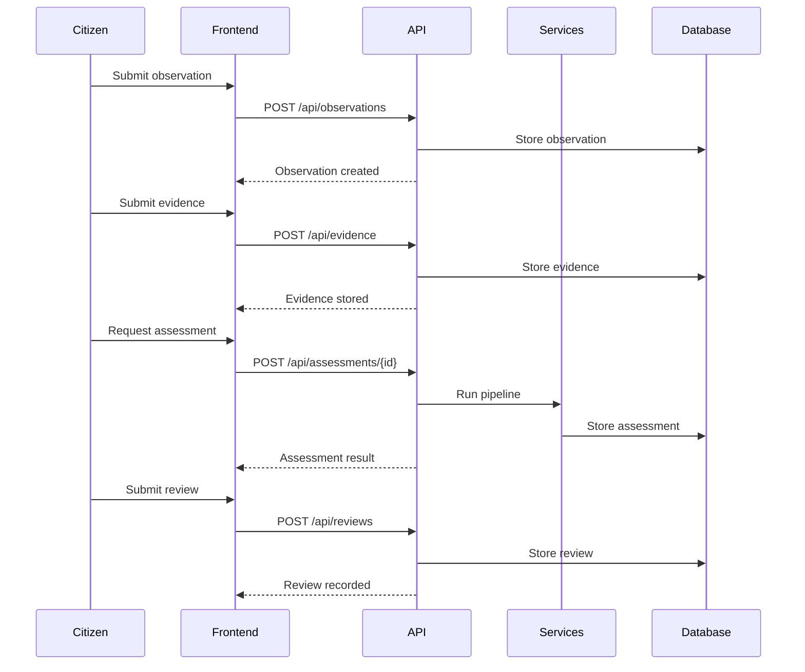

# AquaTrust — Architecture

## System Overview

AquaTrust is a research-oriented MVP that demonstrates evidence-aware AI validation for citizen freshwater observations. The system follows a pipeline architecture where citizen observations are cross-validated against multiple evidence sources.

## Architecture Diagram



## Component Descriptions

### Presentation Layer

**React Frontend** (`frontend/`)
- Vite build tool
- Tailwind CSS for styling
- TypeScript for type safety
- Component-based architecture
- API proxy to backend

### API Layer

**FastAPI Router** (`backend/app/api/`)

| Router | File | Endpoints |
|--------|------|-----------|
| Observations | `observations.py` | CRUD for citizen observations |
| Evidence | `evidence.py` | CRUD for evidence records |
| Assessments | `assessments.py` | Assessment pipeline orchestration |
| Reviews | `reviews.py` | Human review workflow |
| Demo | `demo.py` | Demo scenario endpoints |

### Service Layer

**Core Services** (`backend/app/services/`)

| Service | File | Purpose |
|---------|------|---------|
| Evidence Service | `evidence_service.py` | Retrieve and normalize evidence |
| Alignment Service | `alignment_service.py` | Spatial, temporal, quality alignment |
| Conflict Engine | `conflict_engine.py` | Deterministic conflict detection |
| Reliability Engine | `reliability_engine.py` | Reliability and confidence calculation |
| Assessment Engine | `assessment_engine.py` | Final assessment label |
| Explanation Service | `explanation_service.py` | Human-readable explanations |
| Next Evidence Service | `next_evidence_service.py` | Rule-based recommendations |
| Demo Service | `demo_service.py` | Four deterministic scenarios |

### Data Layer

**SQLAlchemy Models** (`backend/app/models/`)

| Model | File | Table |
|-------|------|-------|
| Observation | `observation.py` | observations |
| Evidence | `evidence.py` | evidence |
| Assessment | `assessment.py` | assessments |
| Review | `review.py` | reviews |
| EvidenceComparison | `comparison.py` | evidence_comparisons |

## Data Flow



## Assessment Pipeline

```mermaid
graph LR
    A[Observation] --> B[Evidence Retrieval]
    B --> C[Evidence Normalization]
    C --> D[Alignment Scoring]
    D --> E[Conflict Detection]
    E --> F[Reliability Calculation]
    F --> G[Confidence Calculation]
    G --> H[Assessment Label]
    H --> I[Explanation Generation]
    I --> J[Next Evidence Recommendation]
    J --> K[Human Review Trigger]
```



## Design Decisions

### Why SQLite by default?

The demo must run with zero external dependencies. SQLite provides this while maintaining the same SQLAlchemy ORM interface. PostgreSQL can be used in production by changing the `DATABASE_URL` environment variable.

### Why deterministic conflict detection?

The research contribution is **inspectable** evidence validation. Using an LLM for conflict detection would make the system a black box. Deterministic rules make every decision traceable and explainable.

### Why separate reliability and confidence?

- **Reliability** measures the evidence itself (source quality, coverage, diversity)
- **Confidence** measures the assessment conclusion (agreement, reliability, evidence status)

These are fundamentally different concepts and must not be conflated.

### Why rule-based next evidence?

The MVP prioritizes transparency over complexity. Rule-based recommendations are inspectable and modifiable. Reinforcement learning would add opacity without clear benefit for the research demonstration.

## External Provider Interfaces

The system is designed so that real external APIs can replace the mock providers:

```python
class SensorProvider(Protocol):
    def get_measurements(self, lat: float, lon: float, timestamp: datetime) -> dict: ...

class WeatherProvider(Protocol):
    def get_weather(self, lat: float, lon: float, timestamp: datetime) -> dict: ...

class SatelliteProvider(Protocol):
    def get_anomaly_score(self, lat: float, lon: float, timestamp: datetime) -> float: ...

class HistoricalEvidenceProvider(Protocol):
    def get_baseline(self, lat: float, lon: float) -> dict: ...
```

Currently, demo scenarios use synthetic data. Real providers can be plugged in without changing the core pipeline.

## Technology Stack

| Layer | Technology | Version |
|-------|-----------|---------|
| Backend | Python | 3.14+ |
| API Framework | FastAPI | 0.115+ |
| ORM | SQLAlchemy | 2.0+ |
| Validation | Pydantic | 2.9+ |
| Database | SQLite / PostgreSQL | - |
| Frontend | React | 18+ |
| Build Tool | Vite | 6+ |
| Styling | Tailwind CSS | 3+ |
| Language | TypeScript | 5+ |
| Testing | pytest | 8+ |

## Project Structure

```
aquatrust/
├── backend/
│   ├── app/
│   │   ├── api/           # FastAPI routers
│   │   │   ├── observations.py
│   │   │   ├── evidence.py
│   │   │   ├── assessments.py
│   │   │   ├── reviews.py
│   │   │   └── demo.py
│   │   ├── models/        # SQLAlchemy models
│   │   │   ├── observation.py
│   │   │   ├── evidence.py
│   │   │   ├── assessment.py
│   │   │   ├── review.py
│   │   │   └── comparison.py
│   │   ├── schemas/       # Pydantic schemas
│   │   │   ├── observation.py
│   │   │   ├── evidence.py
│   │   │   ├── assessment.py
│   │   │   └── review.py
│   │   ├── services/      # Core business logic
│   │   │   ├── evidence_service.py
│   │   │   ├── alignment_service.py
│   │   │   ├── conflict_engine.py
│   │   │   ├── reliability_engine.py
│   │   │   ├── assessment_engine.py
│   │   │   ├── explanation_service.py
│   │   │   ├── next_evidence_service.py
│   │   │   └── demo_service.py
│   │   ├── config.py
│   │   ├── database.py
│   │   └── main.py
│   ├── Dockerfile
│   └── requirements.txt
├── frontend/
│   ├── src/
│   │   ├── components/    # React components
│   │   │   ├── ObservationForm/
│   │   │   ├── EvidencePanel/
│   │   │   ├── ConfidenceCard/
│   │   │   ├── ConflictPanel/
│   │   │   ├── ReviewPanel/
│   │   │   └── NextEvidenceCard/
│   │   ├── pages/         # Page components
│   │   ├── api/           # API client
│   │   │   └── client.ts
│   │   ├── types/         # TypeScript types
│   │   │   └── index.ts
│   │   ├── App.tsx
│   │   ├── main.tsx
│   │   └── index.css
│   ├── index.html
│   ├── package.json
│   ├── vite.config.ts
│   ├── tailwind.config.js
│   ├── postcss.config.js
│   └── tsconfig.json
├── tests/                 # Pytest test suite
│   ├── conftest.py
│   ├── test_alignment.py
│   ├── test_conflict_engine.py
│   ├── test_reliability_engine.py
│   ├── test_assessment_engine.py
│   └── test_scenarios.py
├── experiments/           # Evaluation scripts
│   └── evaluate.py
├── docs/                  # Documentation
│   ├── architecture.md
│   ├── methodology.md
│   ├── research.md
│   ├── setup.md
│   └── features.md
├── data/                  # Data directories
│   ├── raw/
│   ├── processed/
│   └── demo/
├── README.md
├── .env.example
└── docker-compose.yml
```

## Security Considerations

- No authentication (research prototype only)
- CORS enabled for development (configure for production)
- Input validation via Pydantic schemas
- SQL injection prevention via SQLAlchemy ORM
- No API keys stored in repository

## Scalability Considerations

- Stateless API design
- Database connection pooling via SQLAlchemy
- Frontend build optimization via Vite
- Potential for horizontal scaling with load balancer
